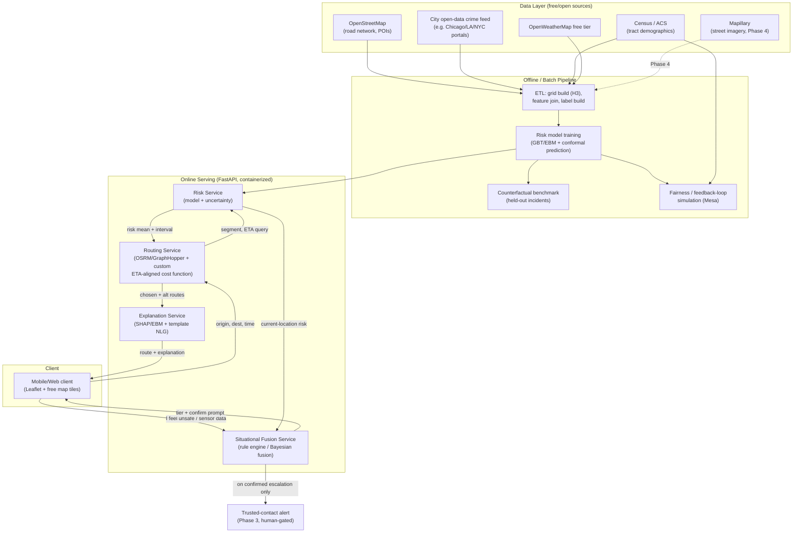
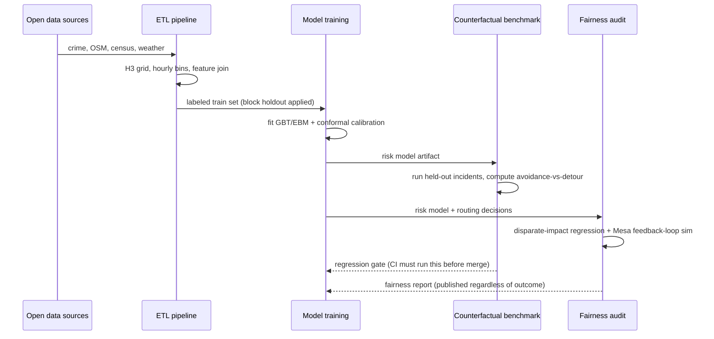
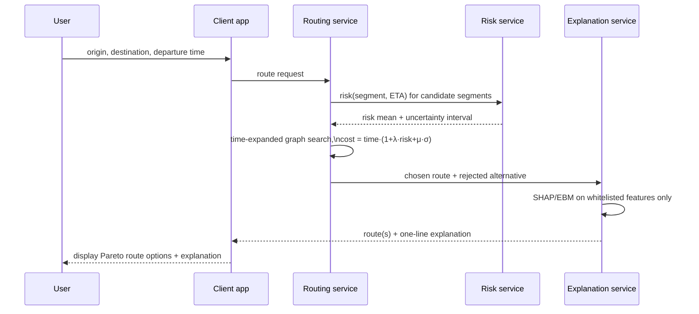
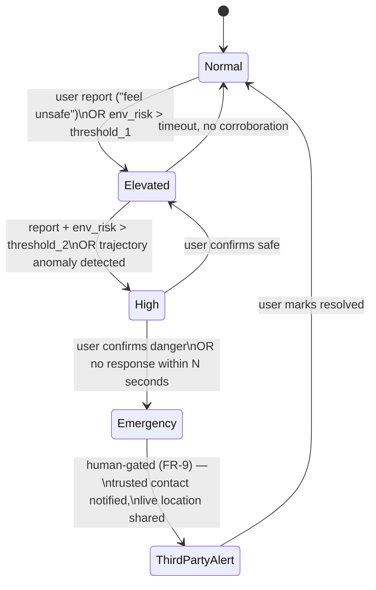

# Product Requirements Document: SafeRoute — Explainable, Context-Aware Safety Routing

**Status:** Draft v1 · **Owner:** [you] · **Derived from:** `literature survey.md` (26 non-arXiv papers 2025–26, gaps G1–G7 / P1–P5)
**Stack constraint:** every component below is free — open-source software, free-tier cloud services, or public open data. Where a free tier has a hard limit, the limit is stated; nothing here silently assumes a paid plan.
**Naming note:** "SafeRoute" collides with prior academic/commercial work (Levy et al.'s RL router, ACM TIST ~2020; several shipped apps). Fine as an internal/working name; rename before any public launch or publication.

---

## 1. Overview

SafeRoute predicts pedestrian safety risk for a street segment **at the time a traveller will actually be there**, routes against that risk with the model's own uncertainty priced in, explains each route choice in terms a user can act on, and — unlike every system found in the literature survey — is audited for whether it systematically routes people around specific neighborhoods. A secondary module fuses a user's real-time situation report ("I feel unsafe") with the same environmental risk signal to drive a graded, human-gated escalation response.

Every requirement below traces to a specific gap (G1–G7) and problem statement (P1–P5) from `literature survey.md`. Nothing is in scope that doesn't close one of those gaps — this is deliberate, to avoid the overbuilding failure mode the survey's own Tier-D cluster (#12, #18) fell into: shipping alert hardware with no risk model behind it.

## 2. Goals and non-goals

**Goals**
- G1/P1: route on ETA-aligned, uncertainty-aware predicted risk, not static or same-day risk.
- G5/P2: evaluate routes against real held-out incidents (avoidance rate vs. detour cost), not offline accuracy alone.
- G2/P3: audit the router for demographic disparate impact and simulate the footfall feedback loop.
- G3/P4: explain each route choice using only actionable, modifiable environmental features.
- G4/P5: fuse a user-reported situation with environmental risk into a graded, human-confirmed escalation — never an unconfirmed auto-dispatch to a third party.

**Non-goals (explicitly out of scope)**
- Predicting or preventing a specific crime in real time (no claim of causal crime prevention — see `literature survey.md`'s reality-check on this exact overclaim).
- Automated, unconfirmed contact with police or emergency services (no public auto-dispatch API exists; every escalation past "alert trusted contacts" requires a human confirmation step or a timed no-response window — never a silent auto-call).
- Building a new SOS-alert app (cluster D of the survey is already saturated — 6 of 26 papers are this, 4 of them Tier D). SafeRoute is the risk model + router + explainability + fairness layer; alerting is a thin, late-stage integration on top.
- A general-purpose maps product. SafeRoute computes a risk-adjusted route; turn-by-turn rendering can sit on any existing map front end.

## 3. Scope and phasing

Phased to keep each release buildable and testable on its own, per the lean-build principle: strict scope, explicit stop condition per phase.

| Phase | Closes | Deliverable | Stop condition |
|---|---|---|---|
| **MVP** | G1/P1, G5/P2, G3/P4 | Risk model + ETA-aligned uncertainty-aware router + contrastive explanation + released counterfactual benchmark, one city, offline crime data | Benchmark run produces an avoidance-vs-detour Pareto curve beating the static-risk baseline; explanation passes the faithfulness test |
| **Phase 2** | G2/P3 | Fairness/redlining audit + feedback-loop simulation, published as a report against the MVP router | Disparate-impact metric computed and published, whatever the result — a negative finding is still a finding |
| **Phase 3** | G4/P5 | Situational-report fusion + graded escalation + trusted-contact alert integration | False-escalation rate measured against a fixed-response baseline in a scenario test matrix, before any live user pilot |
| **Phase 4 (future)** | G6 | Perceived-safety (street-view) signal fused into the uncertainty term | Only if Phase 2 shows the recorded-crime-only model has high uncertainty in a way perception data would resolve |

## 4. Users and personas

- **Primary user:** a pedestrian (any gender; the motivating case is women's urban safety) requesting a route on a phone, at a specific departure time.
- **Trusted contact:** a person the primary user has pre-registered, who receives location shares and escalation alerts.
- **Researcher/auditor:** consumes the Phase 2 fairness report and the Phase-MVP benchmark artifact — this persona is why the benchmark and audit are *released*, not just run internally.
- **City/civic-tech partner (optional, Phase 2):** provides ground truth (e.g., historical redlining boundaries, local safety-audit data) to validate the fairness audit externally, per the survey's recommendation not to self-grade fairness.

## 5. Functional requirements

| ID | Requirement | Closes | Acceptance criteria |
|---|---|---|---|
| FR-1 | Predict risk for any (segment, arrival-time) pair, with a calibrated uncertainty interval | G1 | Conformal-prediction interval has ≥90% empirical coverage on held-out data |
| FR-2 | Given origin, destination, and departure time, return a route whose cost accounts for ETA-aligned risk and its uncertainty | G1/G7 | Route differs measurably from a static-risk router on ≥X% of test OD pairs (ablation, see §12) |
| FR-3 | Return 2–3 Pareto-alternative routes (fast / balanced / cautious) with detour cost and risk-reduction shown per option | P1 | Every returned route is on the risk-vs-time Pareto frontier (no dominated route returned) |
| FR-4 | For the chosen route, generate a one-line explanation naming only whitelisted features (lighting, footfall, open businesses, CCTV, distance-to-help) | G3 | Zero explanations reference a non-whitelisted feature in a 1,000-route audit sample |
| FR-5 | Evaluate the router against held-out real incidents; report avoidance rate vs. detour-cost curve | G5 | Benchmark script runs end-to-end on public data and produces the curve + bootstrap CIs |
| FR-6 | Compute demographic disparate impact of routing decisions across a city's census tracts | G2 | Report published with the four-fifths-rule ratio and confidence interval, positive or negative result |
| FR-7 | Simulate the footfall feedback loop under adoption rates *p* ∈ {0, 0.1, 0.3, 0.5} | G2 | Risk-drift plot produced per *p*; documented, not silently discarded if it shows a problem |
| FR-8 | Accept a free-text or button-based situation report ("I feel unsafe" / "being followed") and combine it with current environmental risk into a tier (normal/elevated/high/emergency) | G4 | Deterministic given the same inputs; tier and reasoning are logged and auditable |
| FR-9 | Require explicit user confirmation or an N-second no-response window before any trusted-contact alert or emergency pre-dial fires | G4 (ethics constraint) | No code path exists that contacts a third party without this gate |

## 6. Non-functional requirements

| Category | Requirement |
|---|---|
| Latency | Route request (FR-2/3) returns in <1.5s p95 for a city-sized graph on free-tier compute (see §14 cost model) |
| Privacy | Live location and trip history are not retained beyond the active session unless the user opts in; no location data leaves the device to a third party without the FR-9 gate |
| Data minimization | Situation reports (FR-8) are not stored with raw text beyond what's needed for the session; aggregate only for model improvement, with consent |
| Auditability | Every routing decision, explanation, and escalation tier logs the inputs that produced it (for the fairness audit and for any liability review) |
| Availability | MVP target: single-region, best-effort (free-tier hosting has no SLA — documented, not hidden) |
| Accessibility | Explanation strings and escalation UI meet WCAG 2.1 AA at minimum (screen-reader compatible; this is a safety product) |
| Reproducibility | Every offline pipeline (training, benchmark, fairness audit) runs from a pinned `requirements.txt`/`environment.yml` and a documented data-download script — no manual, undocumented data prep |

## 7. System architecture

**Component notes**

- **ETL / grid build:** H3 hexagons (~100 m) × hourly bins, built with `h3-py` (free, Uber open source).
- **Risk model:** trains offline (§8 stack), served via a thin FastAPI wrapper. Batch retraining, not online learning — keeps behavior auditable and reproducible (NFR: reproducibility).
- **Routing service:** built on **OSRM** or **GraphHopper** (both free, open-source, self-hostable routing engines with pluggable edge-weight functions) rather than reimplementing Dijkstra/A* from scratch — production-grade routing engines already handle the graph-scale and latency problem; the custom part is the ETA-aligned, risk-and-uncertainty edge-cost function plugged into them.
- **Explanation service:** computes SHAP/EBM attributions restricted to the feature whitelist (FR-4), converts to template strings. No LLM dependency in the MVP — keeps latency and cost at zero marginal.
- **Fusion service (Phase 3):** a deterministic rule engine (plain Python state machine, or `durable_rules` — free, open source) — not a black-box classifier, so FR-9's gate is inspectable.
- **Client:** Leaflet.js + OpenStreetMap tiles (free); no paid maps SDK required for MVP.

## 8. Tech stack (100% free)

| Layer | Tool | License / Cost | Purpose |
|---|---|---|---|
| Road network & routing | **OSRM** or **GraphHopper** | Open source (BSD / Apache-2.0), self-hosted, free | Time-dependent shortest-path engine, custom edge weights |
| Geospatial DB | **PostgreSQL + PostGIS** | Open source, free | Store grid, risk surface, incident data |
| Spatial indexing | **h3-py** (Uber H3) | Apache-2.0, free | Hexagonal risk grid |
| ML — tabular risk model | **XGBoost / LightGBM**, **scikit-learn** | Open source, free | Baseline and primary risk model |
| ML — interpretable-by-design alt. | **InterpretML (EBM)** | MIT license, free (Microsoft OSS) | Faithful-by-construction explanations |
| Uncertainty | **MAPIE** (conformal prediction), **NGBoost** | Open source, free | Calibrated prediction intervals |
| Explainability | **SHAP** | MIT license, free | Post-hoc attribution, faithfulness testing |
| Fairness audit | **Fairlearn** (Microsoft) or **AIF360** (IBM) | Open source, free | Disparate-impact metrics |
| Feedback-loop simulation | **Mesa** (Python agent-based modeling) | Apache-2.0, free | Footfall-redistribution simulation |
| API layer | **FastAPI** + **Uvicorn** | MIT license, free | Serving risk, routing, explanation, fusion endpoints |
| Containerization | **Docker** + **docker-compose** | Free (Docker Desktop free tier / Docker Engine OSS) | Local + deployable packaging |
| CI/CD | **GitHub Actions** | Free tier (2,000 min/mo private, unlimited public) | Test + benchmark runs on every commit |
| Hosting (MVP) | **Render.com** or **Fly.io free tier**, or **Supabase** (managed Postgres+PostGIS free tier) | Free tier, hard resource limits — documented in §14 | MVP deployment |
| Frontend map | **Leaflet.js** + **OpenStreetMap tiles** | BSD-2 / ODbL, free | Client-side map rendering |
| Explanation phrasing (optional) | **Ollama + a small open-weight model** (e.g. Llama-class, Apache/Meta community license) | Free, self-hosted, no per-call cost | Only if template NLG (default, zero-cost) is judged insufficient |
| Monitoring | **Prometheus + Grafana** | Apache-2.0, free | Latency/error tracking once serving is live |
| Testing | **pytest** | MIT license, free | Unit + integration tests, benchmark regression tests |

No component above requires a paid API key or a metered service at MVP scale. Where a free tier has a request cap (OpenWeatherMap, Mapillary), it's noted in §9.

## 9. Data sources (all free / open)

| Source | Data | Access | Free-tier limit |
|---|---|---|---|
| OpenStreetMap (via Overpass API / OSM extracts) | Road network, POIs, lighting tags where present | Free, no key needed for extracts; Overpass has fair-use rate limits | Self-host Overpass for heavy use |
| City open-data portal (e.g. Chicago Data Portal, NYC Open Data, LA GeoHub) | Historic crime incidents, lat/long + timestamp | Free, public, no key | None significant |
| US Census / ACS (or local-country census equivalent for target deployment city) | Tract-level demographics (race, income) for the fairness audit | Free, public | None |
| OpenWeatherMap | Weather context feature | Free tier: 1,000 calls/day | Cache aggressively; weather changes slowly relative to routing |
| Mapillary (Phase 4 only) | Crowdsourced street-level imagery | Free for research/non-commercial use | Rate-limited API |
| Historical redlining maps (e.g. Mapping Inequality project, US-specific) | HOLC boundary overlay for fairness validation | Free, public | — |

**Known constraint (flagged, not hidden):** the richest open crime data (lat/long + timestamp, ready for MVP) is US-city-heavy. If the target deployment city (implied: India) lacks equivalent open data, the MVP validates the *method* on a US city's public data and the transfer to the target city is a documented Phase 2+ data-acquisition task, not an MVP blocker.

## 10. Workflows

### 10.1 Offline: model training and benchmarking

### 10.2 Online: route request

### 10.3 Online: situational escalation (Phase 3)

## 11. API surface (MVP)

| Endpoint | Method | Purpose |
|---|---|---|
| `/v1/route` | POST | `{origin, destination, departure_time, risk_aversion, uncertainty_aversion}` → route(s) + explanation |
| `/v1/risk` | GET | `{segment_id, arrival_time}` → risk mean + interval (internal + debugging use) |
| `/v1/benchmark/run` | POST (CI only) | Triggers the counterfactual benchmark against current model artifact |
| `/v1/fairness/report` | GET | Latest published disparate-impact report (Phase 2) |
| `/v1/situation` | POST (Phase 3) | `{report_type, location, timestamp}` → escalation tier + confirmation prompt |

## 12. Evaluation plan and expected results

| Metric | Method | Target (MVP) |
|---|---|---|
| Uncertainty calibration | Conformal prediction empirical coverage | ≥90% coverage at 90% nominal interval |
| Route difference from static baseline | Ablation: ETA-aligned+uncertainty router vs. static-risk router on N sampled OD pairs | Measurable route divergence on a majority of OD pairs where risk is time-sensitive (e.g., night-time-dependent corridors) |
| Incident avoidance | Counterfactual benchmark (§10.1) | Avoidance rate strictly above the shortest-path control at equivalent detour cost, reported as a Pareto curve — **not** a single headline number, and not claimed above what the curve actually shows |
| Explanation faithfulness | Deletion/insertion test | Predicted-direction score change in ≥90% of sampled explanations |
| Explanation leakage | Whitelist-violation audit (FR-4) | 0 violations in 1,000-route sample |
| Fairness | Four-fifths-rule ratio (FR-6) | Reported transparently; **no target number set in advance** — setting one before measuring would bias the audit. If the ratio falls outside 0.8–1.25, that is reported as a finding requiring mitigation, not adjusted away |
| Feedback-loop drift | Risk drift across simulated adoption rates (FR-7) | Drift magnitude reported per adoption rate; flagged if drift compounds rather than stabilizes |
| Latency | p95 route response time | <1.5s on free-tier compute (§14) |
| False-escalation rate (Phase 3) | Scenario test matrix vs. fixed-response baseline | Lower than fixed-response baseline, measured before any live pilot |

**On "expected results" honesty:** per the survey's own critique of #12 (a paper that reported R²=0.9987 on self-generated labels), no fabricated headline accuracy number belongs in this section. The targets above are calibration and comparative-improvement targets, not point predictions of a final accuracy score — that number doesn't exist until the pipeline runs on real data.

## 13. Milestones / rollout plan

| Milestone | Contents | Rough effort |
|---|---|---|
| M0 — Data pipeline | ETL, H3 grid, one city's open crime + OSM + census loaded into PostGIS | 1–2 weeks |
| M1 — Risk model | GBT/EBM trained, conformal calibration, offline validation | 1–2 weeks |
| M2 — Router | OSRM/GraphHopper deployed with custom ETA-aligned risk cost plugin | 1–2 weeks |
| M3 — Explanation | Whitelisted SHAP/EBM attribution + template NLG | 3–5 days |
| M4 — Benchmark | Counterfactual held-out-incident benchmark, released as a standalone script/dataset split | 1 week |
| M5 — MVP integration | FastAPI services + Leaflet client, end-to-end demo | 1 week |
| **MVP complete** | M0–M5 | ~6–8 weeks solo |
| M6 — Fairness audit (Phase 2) | Disparate-impact regression + Mesa feedback-loop sim, published report | 2 weeks |
| M7 — Situational fusion (Phase 3) | Rule-based fusion service, escalation state machine, trusted-contact integration | 2–3 weeks |

## 14. Cost model (proving the "free" claim, with numbers)

| Item | MVP cost | Where cost would start |
|---|---|---|
| Data | $0 — all sources in §9 are free/public | Only if a paid, higher-resolution crime/imagery feed is later licensed |
| Compute (training) | $0 — runs on a local machine or free-tier CI runner for a single-city dataset at H3-100m/hourly resolution | GPU-heavy deep models (CNN+LSTM, GNN) may need paid compute at national scale; MVP's GBT/EBM does not |
| Hosting | $0 on Render/Fly.io/Supabase free tiers | Free tiers cap CPU/RAM/requests — real user traffic beyond a demo will need a paid tier (this is the honest boundary of "free stack," not hidden) |
| Routing engine | $0 — OSRM/GraphHopper self-hosted | Larger-than-free-tier-memory road graphs (multi-state/national) need more RAM than free tiers provide |
| Third-party APIs | $0 within free-tier call limits (OpenWeatherMap 1,000/day, Mapillary free research tier) | Exceeding those limits |
| LLM (optional) | $0 — self-hosted open-weight model via Ollama, or skip entirely (template NLG is free and is the MVP default) | Only if a hosted paid LLM API is chosen instead of self-hosting |

**Bottom line:** the MVP through Phase 2 is buildable and runnable at $0 direct cost, on free tiers and open-source software, for a single-city prototype at demo/research traffic levels. The one honest ceiling: free-tier hosting has no SLA and caps concurrent load — fine for a research prototype and a benchmark release, not yet a promise of production uptime for real user traffic at scale.

## 15. Risks and mitigations

| Risk | Mitigation |
|---|---|
| Free-tier hosting has no uptime guarantee | Documented in NFR (§6); acceptable for MVP/research scope, flagged before any real-world safety claim is made to users |
| Open crime data is US-heavy; target city may lack equivalent data | Method validated on US open data first; target-city transfer is a scoped, later data-acquisition task (§9) |
| Fairness audit could show a genuine disparate impact | Publish regardless (§12) — the audit's value is in finding this, not hiding it; mitigation options (reweighting, constrained optimization) become Phase 2b work if triggered |
| Explanation whitelist could still leak identity via proxy features | Anti-leakage audit is a named requirement (FR-4 acceptance criteria + the P4 method menu's proxy test) |
| Situational fusion false-escalates and erodes trust, or under-escalates and fails a real emergency | Scenario test matrix + measured false-escalation rate is a hard gate (FR-9, M7) before any live pilot; human-confirmation gate is non-negotiable, not a toggle |
| Users develop false sense of security from the app | Product copy and onboarding must state plainly what the system does and does not do (no "prevents crime" claim — carried over from the original scoping conversation) |

## 16. Success metrics / KPIs (post-MVP, for a live pilot)

- Benchmark avoidance-rate-vs-detour curve published and reproducible by a third party running the released script.
- Fairness report published on schedule (Phase 2), with any adverse finding tracked to a mitigation task, not suppressed.
- p95 latency under budget in production monitoring (Prometheus/Grafana).
- Zero whitelist-violation explanations in ongoing production sampling.
- False-escalation rate stays below the fixed-response baseline established in M7, monitored continuously post-pilot.

---
*This PRD operationalizes every gap and problem statement from `literature survey.md` into buildable, free-stack requirements. It does not include actual code — that's the next step, scoped per milestone above.*
